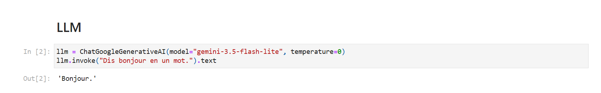
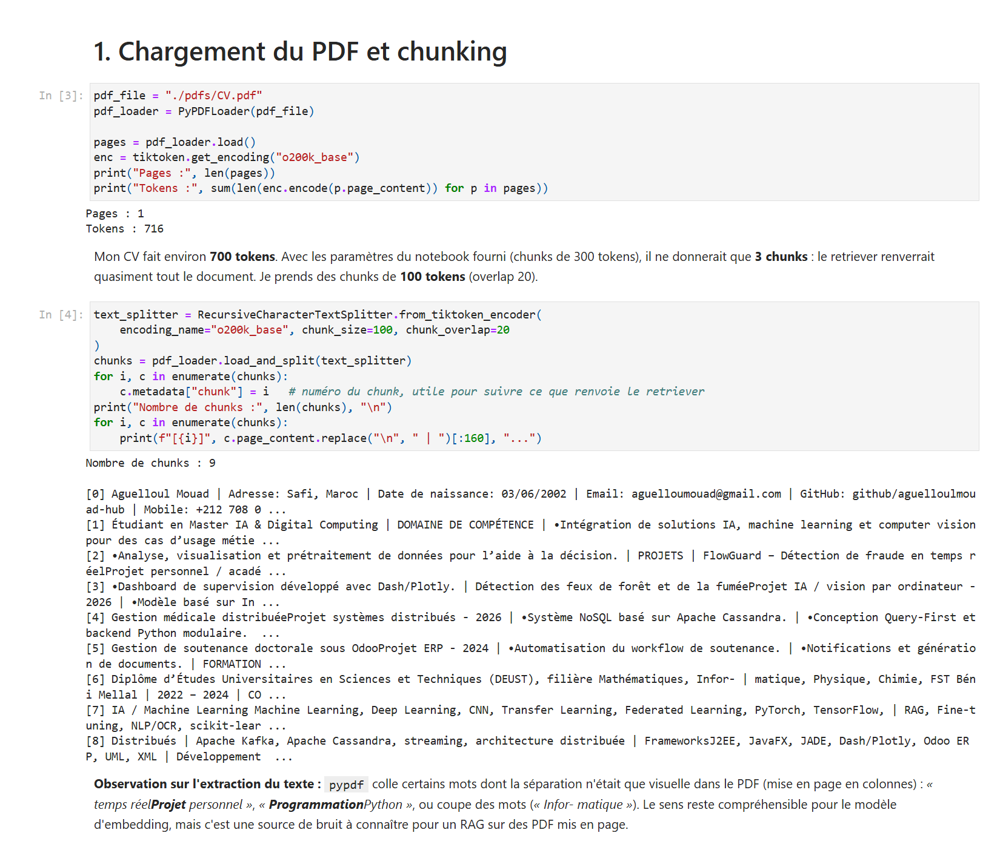
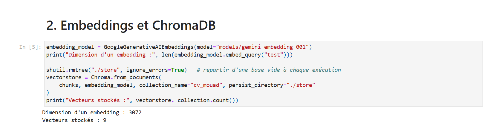
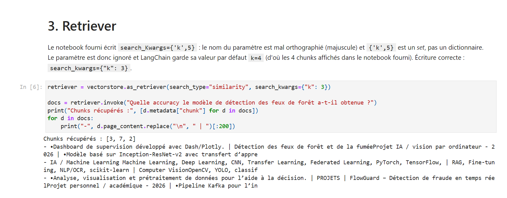
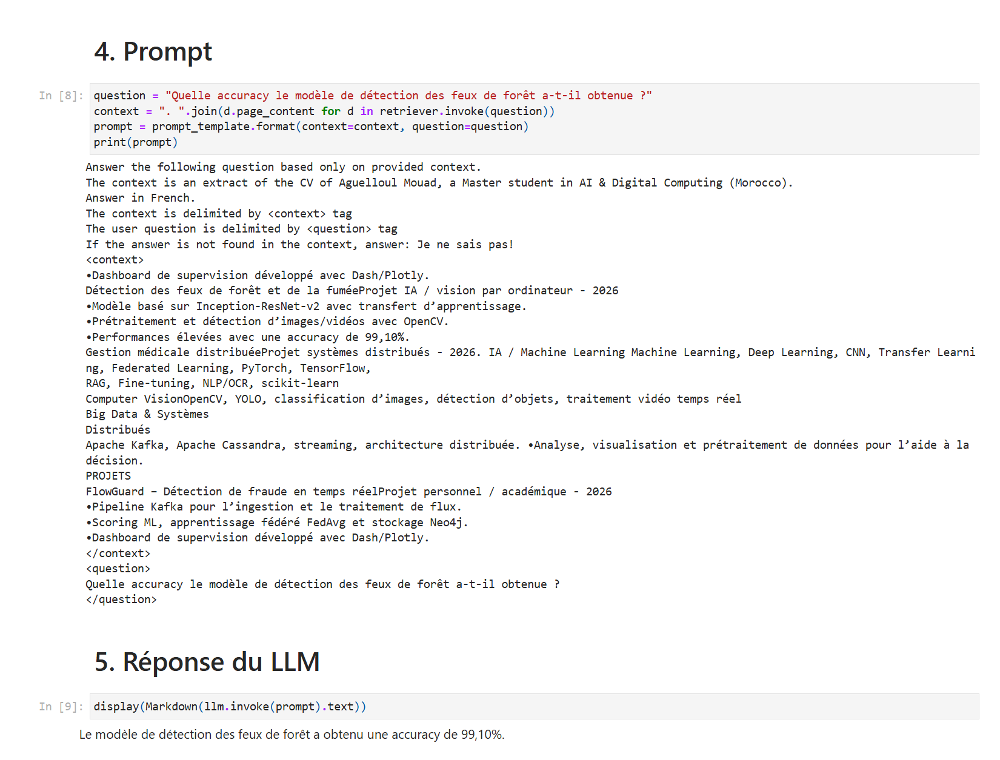
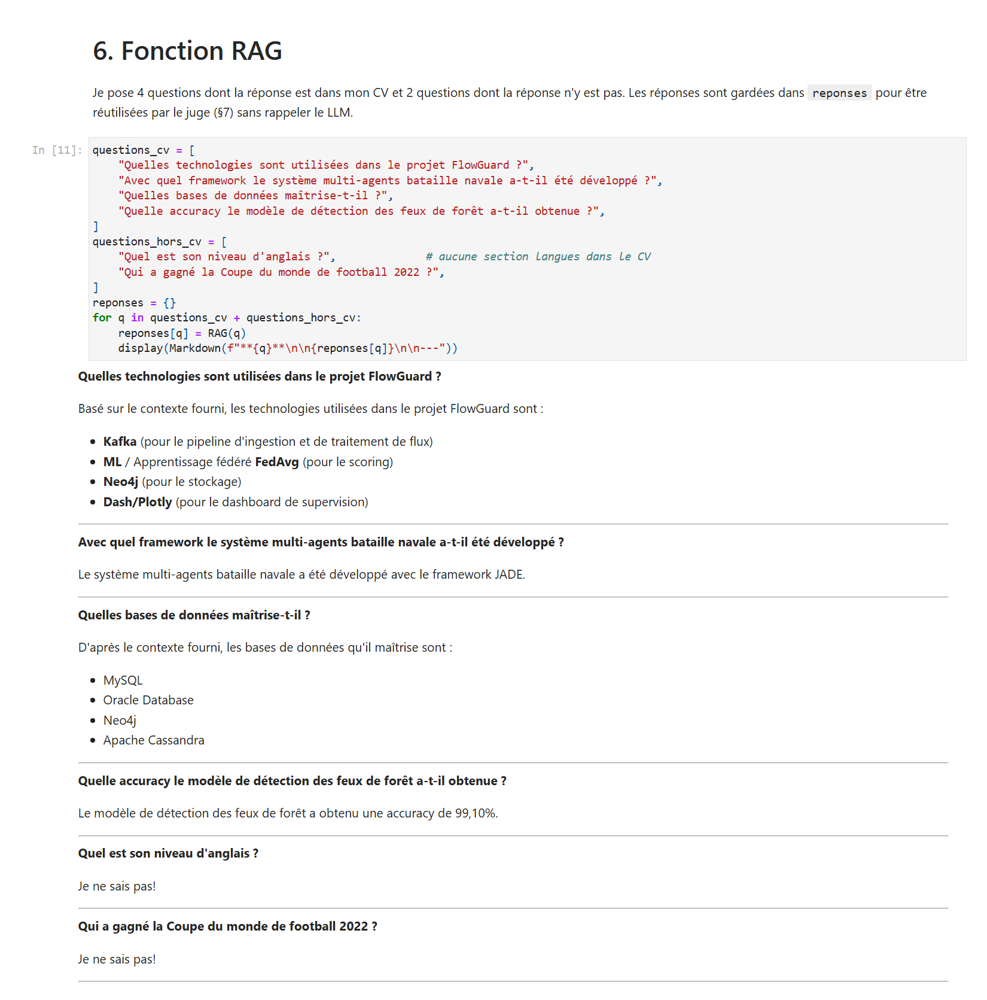
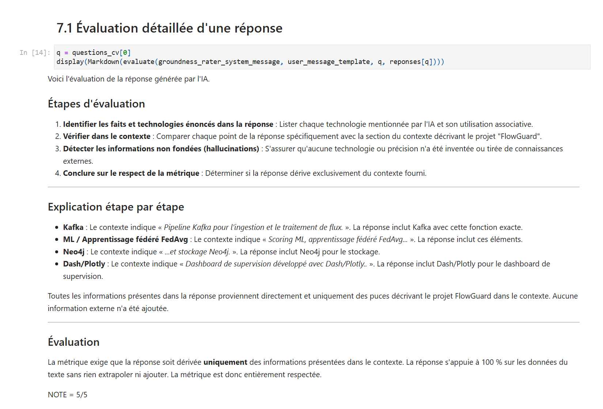
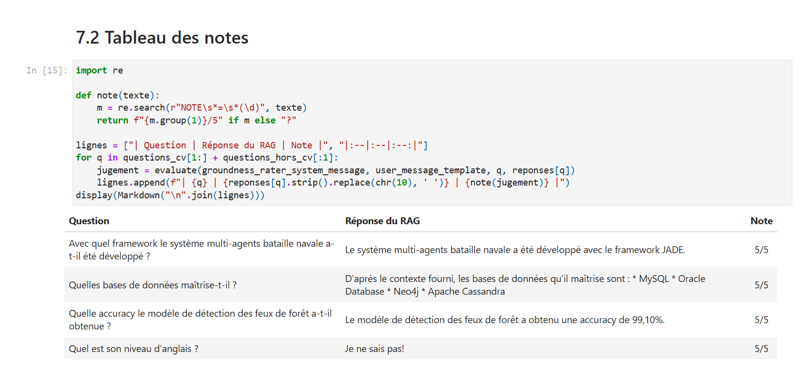
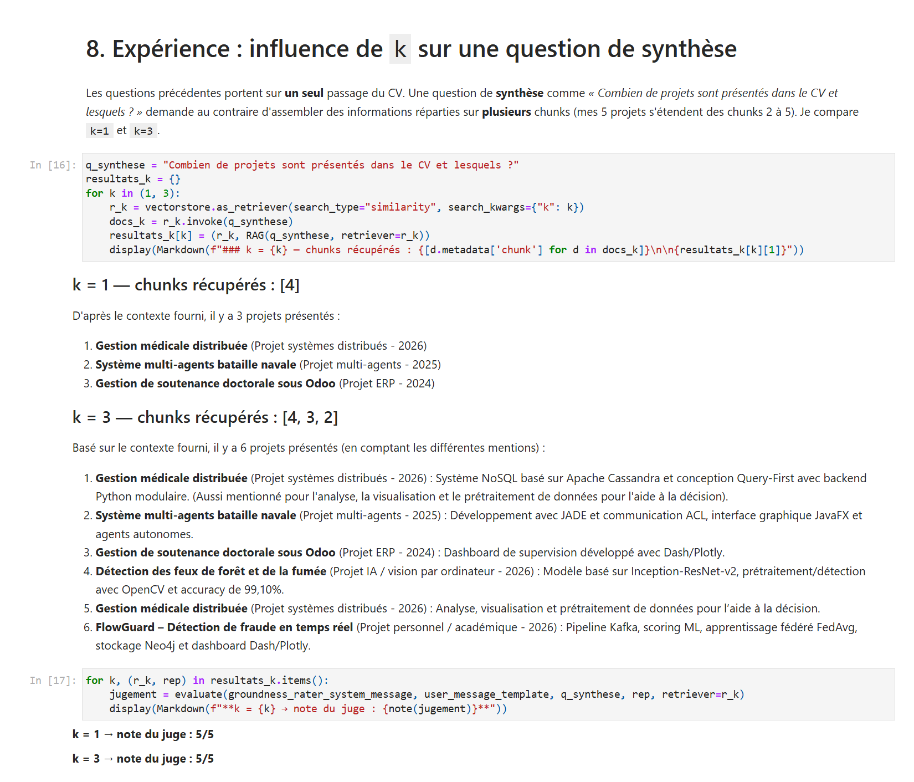
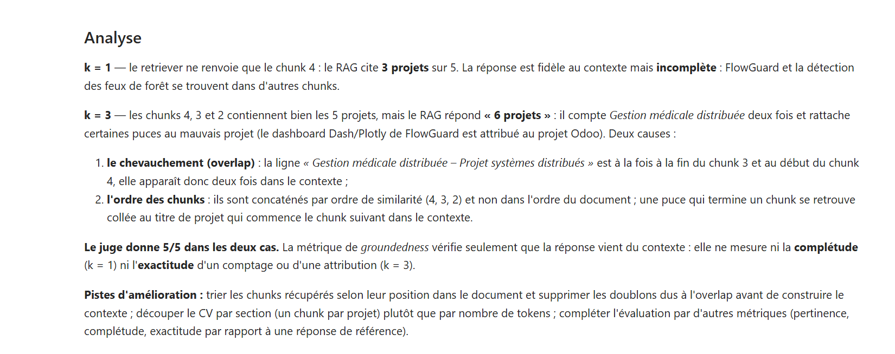

# Réponses — TP4 Application RAG

**Aguelloul Mouad** — Master IA & Digital Computing, FST Béni Mellal
Notebook : [`rag_cv.ipynb`](rag_cv.ipynb)

## 1. Document et objectif

J'ai appliqué le notebook `rag.ipynb` à **mon CV** (`pdfs/CV.pdf`, 1 page). Le but est que le LLM réponde aux questions
en s'appuyant uniquement sur les passages du CV que le retriever lui fournit, et réponde « Je ne sais pas! » sinon.

## 2. Modèles utilisés

Pas de clé OpenAI : j'ai utilisé l'API gratuite **Google Gemini**, comme l'autorise la consigne.

- RAG : `gemini-3.5-flash-lite` (à la place de `gpt-4o-mini`)
- Juge : `gemini-3.5-flash`, plus puissant que le modèle du RAG (à la place de `gpt-4o`)
- Embeddings : `gemini-embedding-001` (à la place de `text-embedding-3-small`)

Adaptations du code : `.text` au lieu de `.content` (les réponses Gemini sont des listes de blocs) et
`langchain_chroma` au lieu de `langchain_community.vectorstores` (déprécié). La clé est dans `.env`, exclu du dépôt.

## 3. Chunking

- Le CV fait **716 tokens**. Avec 300 tokens par chunk (paramètre du notebook fourni), on n'aurait que **3 chunks**, et le
  retriever renverrait presque tout le CV.
- J'ai choisi **100 tokens, overlap 20 → 9 chunks**. Chaque chunk couvre une partie : coordonnées, domaines de
  compétence, 1 à 3 projets, formation, compétences techniques.
- **Extraction du PDF :** `pypdf` colle des mots séparés uniquement par la mise en page (*« temps réelProjet »*,
  *« ProgrammationPython »*) et coupe des mots en fin de ligne (*« Infor- matique »*). Le RAG reste fonctionnel, mais
  c'est du bruit dans les chunks.

## 4. Retriever

Dans le notebook fourni, `search_Kwargs={'k',5}` ne fonctionne pas :
- `search_Kwargs` (avec un K majuscule) n'est pas le bon nom de paramètre, il faut `search_kwargs` ;
- `{'k',5}` est un ensemble (*set*), pas un dictionnaire `{'k': 5}`.

Le paramètre est ignoré et la valeur par défaut `k=4` est utilisée. J'utilise `search_kwargs={"k": 3}`.
Test : pour *« Quelle accuracy le modèle de détection des feux de forêt a-t-il obtenue ? »*, le chunk 3 (celui du projet)
arrive en premier.

## 5. Réponses du RAG

| Question | Réponse | Juste ? |
| :--- | :--- | :---: |
| Technologies du projet FlowGuard ? | Kafka, scoring ML / apprentissage fédéré FedAvg, Neo4j, Dash/Plotly | ✅ |
| Framework du système multi-agents bataille navale ? | JADE | ✅ |
| Bases de données maîtrisées ? | MySQL, Oracle Database, Neo4j, Apache Cassandra | ✅ |
| Accuracy du modèle de détection des feux de forêt ? | 99,10 % | ✅ |
| Niveau d'anglais ? *(absent du CV)* | Je ne sais pas! | ✅ |
| Vainqueur de la Coupe du monde 2022 ? *(hors sujet)* | Je ne sais pas! | ✅ |

Le CV n'a pas de section « Langues » : le modèle ne déduit pas un niveau d'anglais à partir du reste du CV. Pour la
Coupe du monde, il connaît la réponse mais respecte la consigne du prompt.

## 6. Évaluation par le juge

Prompt du juge du notebook fourni, avec une ligne finale imposée `NOTE = x/5` pour extraire la note automatiquement.
Les réponses du §5 sont réutilisées : le RAG n'est pas rappelé une deuxième fois pour l'évaluation.

| Question | Note |
| :--- | :---: |
| FlowGuard | 5/5 |
| Bataille navale (JADE) | 5/5 |
| Bases de données | 5/5 |
| Accuracy feux de forêt | 5/5 |
| Niveau d'anglais (« Je ne sais pas! ») | 5/5 |

## 7. Expérience : influence de `k` sur une question de synthèse

Question : *« Combien de projets sont présentés dans le CV et lesquels ? »* (réponse attendue : **5**, répartis sur les
chunks 2 à 5).

| | Chunks récupérés | Réponse du RAG | Note du juge |
| :--- | :--- | :--- | :---: |
| `k = 1` | 4 | 3 projets (Gestion médicale, Bataille navale, Odoo) | 5/5 |
| `k = 3` | 4, 3, 2 | « 6 projets » : *Gestion médicale distribuée* compté deux fois | 5/5 |

**Analyse :**
- Avec `k = 1`, la réponse est **fidèle mais incomplète** : FlowGuard et les feux de forêt sont dans d'autres chunks.
- Avec `k = 3`, toute l'information est présente mais la réponse est **fausse** :
  1. à cause de l'**overlap**, le titre *« Gestion médicale distribuée »* est à la fois en fin de chunk 3 et en début de
     chunk 4, il apparaît deux fois dans le contexte ;
  2. les chunks sont concaténés **par ordre de similarité (4, 3, 2)** et non dans l'ordre du document : une puce de fin de
     chunk se retrouve collée au titre du chunk suivant, d'où des attributions erronées (le dashboard Dash/Plotly de
     FlowGuard est rattaché au projet Odoo).
- **Le juge met 5/5 aux deux réponses.** La métrique de *groundedness* vérifie que la réponse vient du contexte ; elle ne
  détecte ni une réponse incomplète ni un comptage faux.

**Améliorations possibles :**
- trier les chunks récupérés selon leur position dans le document et retirer les doublons d'overlap avant de construire
  le contexte ;
- découper le CV par section (un chunk par projet) au lieu d'un nombre fixe de tokens ;
- ajouter des métriques de **complétude** et d'**exactitude** (comparaison à une réponse de référence) en plus de la
  groundedness.

## 8. Conclusion

Le RAG est fiable pour les questions **factuelles** qui portent sur un passage précis du CV, et ne répond pas aux
questions hors document. Les questions de **synthèse** sont plus difficiles : elles dépendent de `k`, de l'overlap et de
l'ordre des chunks. Enfin, une bonne note de groundedness ne garantit pas une bonne réponse : l'évaluation d'un RAG doit
combiner plusieurs métriques.

## Captures d'écran

| | |
| :--- | :--- |
| Connexion à Gemini |  |
| Chargement et chunking |  |
| Embeddings et ChromaDB |  |
| Retriever |  |
| Prompt et réponse du LLM |  |
| Réponses du RAG |  |
| Évaluation détaillée par le juge |  |
| Tableau des notes |  |
| Expérience sur `k` |  |
| Analyse |  |
